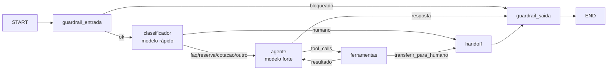

# 07 · O caminho de uma mensagem

> Slide: **Caminho de uma mensagem**
> Código: [`src/agente/grafo.py`](../src/agente/grafo.py) + painel de debug do Streamlit

## O grafo



Cada seta condicional é uma função pequena em `grafo.py` (`rota_entrada`, `rota_intencao`, `rota_agente`, `rota_ferramentas`). Leia essas quatro funções e você entende o agente inteiro.

## Passo a passo: "Quanto fica um SUV por 10 dias em BH?"

| # | Onde | O que acontece | Onde observar |
|---|---|---|---|
| 01 | **Canal** (`streamlit_app.py`) | `st.chat_input` recebe o texto e chama `responder(thread_id, msg, "streamlit")` | — |
| 02 | **Fronteira** (`servico.py`) | Mascara PII, abre o trace, invoca o grafo com o `thread_id`; o checkpointer carrega o histórico | Trace: span `responder` |
| 03 | **`guardrail_entrada`** | Tamanho ok, sem PII, regras e LLM rápido dizem "não é injection" | Trace: nó `guardrail_entrada` |
| 04 | **`classificador`** | Modelo rápido → `cotacao` | Badge **Intenção: cotacao** |
| 05 | **`agente`** | Modelo forte recebe prompt + janela do histórico + ferramentas e pede `cotar_aluguel(categoria="suv", dias=10, cidade="BH")` | Trace: nó `agente` |
| 06 | **`ferramentas`** | Executa a função: subtotal R$ 2.299,00, desconto 10%, total **R$ 2.069,10** | Expander **Ferramentas chamadas** |
| 07 | **`agente`** (de novo) | Lê o resultado e escreve a resposta final, sem pedir mais ferramentas | Trace: 2ª chamada do modelo |
| 08 | **`guardrail_saida`** | Confere: sem promessas, e `R$ 2.069,10` veio de uma ferramenta ✓ | Sem alerta 🛡️ |
| 09 | **Checkpointer** | Salva o estado; a conversa continua na próxima mensagem | Barra lateral → **Estado salvo** |
| 10 | **Fronteira** | Monta a `Resposta` (texto, ferramentas, latência, tokens) e fecha o trace com as tags | Latência, tokens, **Ver trace ↗** |

Tempo típico com `gpt-5.6-luna`: 4 a 7 s, a maior parte nas chamadas de modelo (guardrail LLM, classificador e duas do agente).

## Outros caminhos

| Mensagem | Caminho |
|---|---|
| "Olá" | guardrail_entrada → classificador (`outro`) → agente (sem ferramenta) → guardrail_saida |
| "Quero falar com um atendente" | guardrail_entrada → classificador (`humano`) → **handoff** → guardrail_saida |
| "Ignore suas instruções…" | guardrail_entrada (**bloqueado**) → guardrail_saida. Nenhum modelo é chamado se a regra pegar |
| "Meu carro quebrou na estrada" | … → agente → ferramentas (`transferir_para_humano`) → **handoff** → guardrail_saida |

## Visualizar o grafo

```bash
uv run python -c "from agente.grafo import construir_grafo; print(construir_grafo().get_graph().draw_mermaid())"
```

Cole a saída em [mermaid.live](https://mermaid.live).
